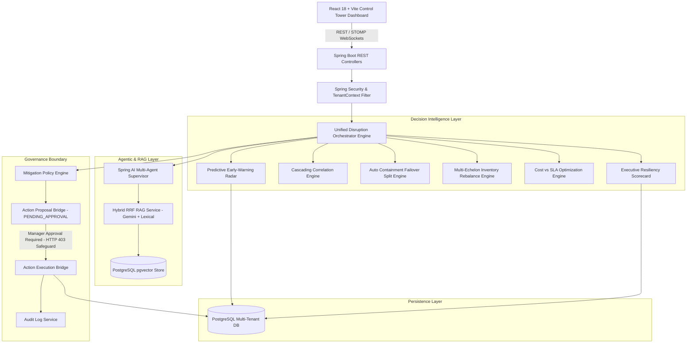

# AI Supply Chain Control Tower 🚀

An enterprise-grade, real-time AI-powered Supply Chain Control Tower built with **Spring Boot 3.3.4 (Java 21)**, **Spring AI (Google Gemini Embeddings & Agentic Consensus)**, **PostgreSQL (pgvector)**, **React 18 (TypeScript & Vite)**, and **Phase 2 Multi-Tenant Architecture**.

The system transforms enterprise supply chain management from reactive triage into proactive, deterministic, and explainable decision intelligence across global multi-echelon supply networks.

---

## 🌟 Executive Overview & Key Capabilities

The Control Tower integrates 16 specialized analytical and decision-intelligence engines:

1. **Hybrid RAG Knowledge Search**: Reciprocal Rank Fusion (RRF) search fusing vector embeddings (Google Gemini `gemini-embedding-001` with 768 dimensions in pgvector) and lexical candidate matching over operational manuals, disruption runbooks, and supply chain policies with tenant-level scoping.
2. **Multi-Agent Supervisor Consensus**: Collaborative multi-agent reasoning architecture (`SupervisorAgent`, `InventoryAgent`, `SupplierAgent`, `LogisticsAgent`, `WarehouseAgent`, `RiskAgent`) powered by Spring AI with grounded database tools.
3. **Disruption Stress-Testing Simulator**: Simulates multi-domain supply chain shocks across demand surges, lead time delays, and capacity bottlenecks (`/api/public/simulation/disruption`).
4. **Multi-Domain Risk Analysis Engine**: Evaluates supplier OTIF, warehouse capacity utilization, stockout horizons, and logistics transit delays.
5. **Automated Mitigation Policy Engine**: Formulates risk-mitigation proposals held in `PENDING_APPROVAL` status.
6. **Human-in-the-Loop Manager Authorization Boundary**: Real-world consequential action execution strictly requires manager JWT Bearer token authorization (`POST /api/actions/{id}/approve`), with unauthenticated requests returning `HTTP 403 Forbidden`.
7. **Policy Action Execution Bridge**: Executes approved actions, synchronizes operational inventory levels, and updates purchase orders or stock transfers with immutable audit logs.
8. **Automated Purchase Order Replenishment**: Computes economic order quantities (EOQ), reorder triggers, and issues purchase orders.
9. **Post-Recovery Residual Risk Evaluation**: Evaluates post-execution risk reduction ($75.0 \rightarrow 18.0$, band `LOW`) after mitigations are applied.
10. **Cascading Disruption Correlation & Risk Topology**: Maps multi-hop disruption propagation chains (Supplier $\rightarrow$ Warehouse $\rightarrow$ Logistics $\rightarrow$ Customer SLA).
11. **Predictive Disruption Early-Warning Radar**: Detects stockout anomalies 2-to-5 days before escalation.
12. **Cost vs. SLA Speed Optimization**: Evaluates cost versus customer SLA speed tradeoffs to identify Pareto-optimal recovery pathways.
13. **Historical Mitigation Effectiveness Analytics**: Analyzes historical recovery success rates across disruption categories.
14. **Executive Command Center & Resiliency Scorecard**: Computes the overall Supply Chain Resiliency Index ($0-100$, status `OPTIMAL`).
15. **Automated Disruption Containment & Failover Split Router**: Computes multi-supplier order volume split allocations (e.g., $60/40$) during vendor outages.
16. **Multi-Echelon Inventory Rebalancing Engine**: Computes cross-dock inter-hub stock transfers to satisfy deficits without new external procurement.

---

## 🏢 Multi-Tenancy Architecture (Phase 2)

The application implements strict enterprise multi-tenancy:
- **Tenant Isolation**: Every operational entity (Products, Inventory, Suppliers, Warehouses, Shipments, Customer Orders, Risk Alerts, Action Proposals) is partitioned by `company_id` / `company_code`.
- **JWT Tenant Context**: `TenantContext` extracts the authenticated tenant company from verified JWT claims (`control_tower_token`) per request thread.
- **Tenant Ingestion Pipeline**: Ingestion service processes multi-tenant CSV imports with duplicate-detection and per-tenant scoping.
- **Tenant Scoped RAG**: Vector store queries and knowledge document retrieval enforce tenant isolation boundaries, preventing cross-tenant document leakage.

---

## 🏗 System Architecture



---

## 🚀 Deployment

### Staging Environment
- **Staging Frontend**: [Cloudflare Workers](https://ai-supply-chain-control-tower-staging.arnavnandi45.workers.dev)
- **Staging Backend**: [Render Web Service](https://ai-supply-chain-control-tower-backend-nkw0.onrender.com)
- **Staging Database**: Managed PostgreSQL with `pgvector`
- **Telemetry**: Real-time STOMP over SockJS via `/ws/telemetry`

### Local Docker Deployment

#### Prerequisites
- Docker & Docker Compose
- Java 21 (optional, for local maven builds)
- Node.js 20+ (optional, for local frontend development)

#### 1. Launch Complete Application Stack
```bash
docker compose up -d --build
```

#### 2. Service Access Points
- **Frontend Dashboard**: `http://localhost:3000`
- **Backend REST API**: `http://localhost:8080`
- **Actuator Health**: `http://localhost:8080/actuator/health`
- **PostgreSQL Vector DB**: `localhost:5432` (`controltower` / `postgres`)

---

## 🛠 Key REST API Endpoints

| Method | Endpoint | Description | Auth Required |
| :--- | :--- | :--- | :--- |
| `GET` | `/api/public/simulation/executive/command-center` | Returns Executive Resiliency Scorecard | No |
| `GET` | `/api/public/simulation/analytics/unified-orchestration` | Generates Master Disruption Containment & Recovery Blueprint | No |
| `GET` | `/api/public/simulation/analytics/failover-containment` | Returns multi-supplier failover allocation ratios | No |
| `GET` | `/api/public/simulation/analytics/multi-echelon-rebalance` | Computes inter-hub stock transfers | No |
| `GET` | `/api/public/simulation/analytics/cost-sla-tradeoff` | Evaluates cost vs SLA speed optimization matrix | No |
| `GET` | `/api/public/simulation/analytics/predictive/early-warnings` | Scans stream for 2-to-5 day stockout anomalies | No |
| `POST`| `/api/public/simulation/disruption` | Injects disruption event for what-if scenario testing | No |
| `GET` | `/api/intelligence/summary` | Returns tenant operational intelligence KPI summary | Yes (JWT) |
| `GET` | `/api/products` | Paginated and filtered tenant catalog products | Yes (JWT) |
| `GET` | `/api/inventory` | Multi-warehouse inventory stock levels | Yes (JWT) |
| `POST`| `/api/inventory/adjust` | Manual inventory stock adjustment | Yes (JWT) |
| `GET` | `/api/actions` | Lists pending and historical AI mitigation actions | Yes (JWT) |
| `POST`| `/api/actions/{id}/approve` | **Human-in-the-Loop Execution** (Requires Manager JWT) | Yes (Manager JWT) |
| `POST`| `/api/actions/{id}/reject` | Reject AI proposed action | Yes (Manager JWT) |

---

## 🧪 Testing & Verification

### Backend Test Suite
```bash
cd backend
mvn test
```
*Result*: `Tests run: 259, Failures: 0, Errors: 0, Skipped: 2` $\rightarrow$ `BUILD SUCCESS`.

### Frontend Test Suite & Build
```bash
cd frontend
npm test
npm run build -- --mode staging
```
*Result*: `37 tests passing (node --test)`, TypeScript check clean (`tsc -b`), Vite production build clean.

---

## 🔒 Security & Governance Safeguards
- **Human-in-the-Loop Gate**: Consequential action execution (purchase order generation, stock rebalancing, vendor rerouting) strictly requires manager JWT Bearer token authorization via `POST /api/actions/{id}/approve`.
- **Tenant Scoping Safeguards**: Cross-tenant data isolation is enforced at repository query level via `TenantContext`.
- **Zero-Unauthenticated Action Execution**: Unauthenticated action execution requests are rejected with `HTTP 403 Forbidden`.
