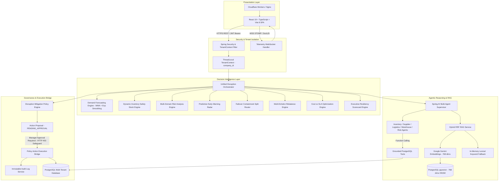

# AI Supply Chain Control Tower 🚀

An enterprise-grade, real-time AI-powered Supply Chain Control Tower built with **Spring Boot 3.3.4 (Java 21)**, **Spring AI (Google Gemini Chat & Embeddings)**, **PostgreSQL 16 (pgvector - 768 dimensions)**, **React 19 (TypeScript, Vite 8, Tailwind CSS v4)**, and a **Phase 2 Multi-Tenant Architecture**.

The system transforms enterprise supply chain management from reactive triage into proactive, deterministic, and explainable decision intelligence across global multi-echelon supply networks.

---

## 🌟 Executive Overview & Problem Addressed

Modern supply chains suffer from fragmented visibility across warehouse silos, carrier delays, vendor unreliability, and sudden stockouts. When disruptions occur, operations teams face three major bottlenecks:
1. **Slow Detection**: Stockout risks and logistics bottlenecks are discovered days after failures begin.
2. **Lack of Explainability**: Legacy systems and opaque AI models issue black-box recommendations without clear database grounding or root-cause metrics.
3. **Execution Risk**: Autonomous AI execution without human-in-the-loop governance risks placing erroneous purchase orders or costly inventory transfers.

The **AI Supply Chain Control Tower** solves these challenges by combining:
- **Deterministic Analytical Engines**: Calculating exact mathematical demand forecasts, dynamic safety stocks, supplier OTIF rates, and multi-echelon rebalancing proposals directly in Java.
- **Human-in-the-Loop (HITL) Governance Boundary**: Requiring authenticated manager authorization (`POST /api/actions/{id}/approve`) for consequential write actions (purchase order generation, stock transfers, supplier failovers).
- **PostgreSQL Telemetry Grounding**: Providing complete root-cause explainability for every risk alert and mitigation recommendation.
- **Multi-Tenant Data Isolation**: Partitioning all operational entities by tenant company with JWT claim verification on every request.

---

## 🎯 Implemented Modules & Functional Capabilities

The application implements 14 operational and analytical modules accessible via the control tower interface:

1. **Executive Control Tower Dashboard (`/`)**:
   - **Command Center Resiliency Scorecard**: Weighted resiliency index ($0-100$, status bands: `OPTIMAL`, `HEALTHY`, `WARNING`, `CRITICAL`) dynamically calculated across Supplier OTIF (30%), Inventory Safety (25%), Warehouse Health (25%), and Historical Mitigation Efficacy (20%).
   - **AI Executive Briefing**: Real-time narrative synthesis grounded directly in live PostgreSQL operational telemetry.
   - **Predictive Disruption Early-Warning Radar**: Automated stream scanner detecting inventory deficits and warehouse overflow anomalies 2-to-5 days before escalation.
   - **Executive KPIs**: Real-time System Risk Score ($0-100$), SKU catalog count, available stock units, total asset valuation across logistics hubs, and supplier reliability percentages with active delayed shipment counters.
   - **Interactive Explainability Modal**: Full diagnostic breakdown showing Problem Detected, Raw PostgreSQL Metric Cause, and Agentic Recommendation.
   - **Operational Charts**: Recharts visualizations for multi-warehouse stock distribution and demand forecasting vs. actual customer orders.

2. **Products & SKU Catalog (`/products`)**:
   - Searchable, debounced catalog with SKU identifiers, unit prices, reorder thresholds, safety stock buffers, and lead times.

3. **Multi-Warehouse Inventory Stock (`/inventory`)**:
   - Live inventory tracking across regional logistics facilities with safety stock indicators, filtering by `ALL`, `LOW_STOCK`, and `OVERSTOCK`, and manual stock level adjustment controls.

4. **Suppliers & OTIF Index (`/suppliers`)**:
   - Vendor profiles, average On-Time In-Full (OTIF) rates, delivery reliability gauges, lead times, contracted product coverage, and risk classifications.

5. **Warehouse Hubs & Storage Capacity (`/warehouses`)**:
   - Storage utilization gauges across distribution centers with automatic capacity status thresholds (<75% Nominal, 75–90% Warning, >90% Critical).

6. **Logistics & Shipment Freight (`/shipments`)**:
   - In-transit cargo tracking, carrier reliability scorecards, top congested transit bottlenecks, and active delay tracking with estimated delivery timelines.

7. **Operational Risk Monitor (`/risks`)**:
   - Multi-domain risk matrix tracking anomalies across inventory deficits, vendor reliability degradation, warehouse overutilization, and cargo delays.

8. **AI Decision & Action Center (HITL Governance) (`/action-center`)**:
   - Automated mitigation proposals held in `PENDING_APPROVAL` status. Managers can authorize or reject proposals, automatically generating purchase orders or rebalancing transfers with immutable audit logs.

9. **Scenario Analytics & Disruption Stress-Testing (`/analytics`)**:
   - **Frontend Interface (9 Interactive Tabs)**: Master Unified Orchestration, Cascading Disruption Correlation, Multi-Echelon Rebalancing, Auto-Containment Failover, Cost vs. SLA Optimization, Historical Mitigation Efficacy, Disruption Stress-Testing Simulation, Demand Forecast Accuracy, and Dynamic Safety Stock Optimization (with the Predictive Early Warning Radar embedded in the Executive Dashboard).
   - **Backend Engine Core (17 Dedicated Java Engines)**:
     1. `UnifiedDisruptionOrchestratorEngine`: Master recovery blueprint synthesizing failovers, rebalancing, and PO generation into an orchestrated timeline.
     2. `CascadingDisruptionCorrelationEngine`: Multi-hop disruption propagation modeling across inventory, vendors, and freight.
     3. `AutoContainmentFailoverEngine`: Automated 60/40 volume split routing across contracted secondary suppliers.
     4. `MultiEchelonInventoryRebalancingEngine`: Inter-hub cross-dock transfer optimization between surplus and deficit facilities.
     5. `CostSlaOptimizationEngine`: Pareto tradeoff optimization balancing freight expediting cost against customer SLA protection.
     6. `StressTestingEngine`: What-If simulation engine projecting deficit units and stockout days under demand surges or vendor delays.
     7. `DemandForecastingEngine`: 30-day forecast calculations via Weighted Moving Average (WMA) and Exponential Smoothing ($\alpha=0.3$).
     8. `ForecastAccuracyEngine`: Statistical Mean Absolute Percentage Error (MAPE) and Root Mean Squared Error (RMSE) against actual orders.
     9. `InventoryOptimizationEngine`: Dynamic safety stock computation ($Z \times \sqrt{L \sigma_d^2 + d^2 \sigma_L^2}$) and optimal Reorder Points ($ROP$).
     10. `PurchaseOrderGeneratorEngine`: Automated Economic Order Quantity ($EOQ = \sqrt{2DS/H}$) purchase order proposals.
     11. `RiskAnalysisEngine`: Multi-domain aggregated risk scoring ($0-100$) across inventory, vendors, warehouses, and transit delays.
     12. `ExecutiveCommandCenterEngine`: Weighted Resiliency Scorecard ($0-100$) dynamically combining OTIF, stock health, warehouse capacity, and historical efficacy.
     13. `PredictiveDisruptionEarlyWarningEngine`: Stream anomaly radar scanner identifying stockout trajectories 2-5 days in advance.
     14. `HistoricalMitigationEfficacyEngine`: Recovery success rate and execution velocity tracking from immutable audit logs.
     15. `PostRecoveryRiskEvaluationEngine`: Residual risk re-evaluation and risk-reduction delta calculation after proposed mitigations.
     16. `SupplierAnalyticsEngine`: Vendor On-Time In-Full (OTIF) metrics, lead time tracking, and risk classification matrices.
     17. `LogisticsAnalyticsEngine`: Carrier transit delay analysis and freight corridor bottleneck tracking.

10. **AI Assistant Workspace (`/ai-assistant`)**:
    - Conversational assistant powered by Spring AI with specialized sub-agents (`SupervisorAgent`, `InventoryAgent`, `SupplierAgent`, `LogisticsAgent`, `WarehouseAgent`, `RiskAgent`) utilizing grounded database tools (`getLowStockProducts`, `getSupplierPerformance`, `getDelayedShipments`, etc.).

11. **Supply Chain Policy Knowledge RAG (`/documents`)**:
    - Tenant-scoped hybrid Reciprocal Rank Fusion (RRF) search combining semantic vector embeddings with lexical keyword matching over supply chain runbooks and standard operating procedures.

12. **System Health & Live Telemetry (`/system-health`)**:
    - Real-time STOMP WebSocket terminal (`/ws/telemetry`), Spring Boot Actuator probe monitors, and Resilience4j circuit breaker state telemetry (`llmService`).

13. **Dataset Ingestion & Pipeline (`/import`)**:
    - Multi-tenant CSV onboarding supporting the required 5-step dependency order: `products.csv` $\rightarrow$ `warehouses.csv` $\rightarrow$ `suppliers.csv` $\rightarrow$ `inventories.csv` $\rightarrow$ `shipments.csv`.

14. **Authentication & Multi-Tenant Security (`/login`)**:
    - Multi-tenant JWT Bearer authentication, tenant code isolation (`DEMO` vs custom company), and optional 2FA Email OTP delivery with cooldown and expiry timers.

---

## 🏗 System Architecture & Data Flow



---

## 🏢 Multi-Tenancy Architecture (Phase 2)

The application enforces strict data partitioning across all layers:

- **Database Partitioning**: Relational entities (`products`, `warehouses`, `suppliers`, `supplier_products`, `inventories`, `shipments`, `customer_orders`, `risk_alerts`, `recommendations`, `audit_logs`, `document_metadata`) contain a foreign key `company_id`.
- **JWT Tenant Context**: `JwtAuthenticationFilter` extracts claims (`sub`, `id`, `email`, `role`, `companyId`, `companyCode`) from the verified Bearer token and binds them to `TenantContext` for the lifetime of the request thread.
- **Repository-Level Filtering**: Spring Data JPA repositories filter records by `company_id` (e.g. `findByCompanyId(...)`), preventing cross-tenant data leakage.
- **Tenant-Scoped Vector Store**: Knowledge documents and chunk embeddings are indexed with metadata containing `company_id`, ensuring RAG searches only retrieve documents belonging to the authenticated tenant.
- **Isolated Demo Environment**: Initial database migration seeds Company ID 1 (`DEMO` / Demo Supply Chain Corp) with demonstration datasets, while newly registered companies start with an empty, isolated operational workspace.

---

## 🤖 AI & LLM Integration Architecture

| Component | Implementation | Fallback / Safeguard |
| :--- | :--- | :--- |
| **LLM Chat Model** | Google Gemini (`gemini-3.5-flash` or configurable) via Spring AI OpenAI-compatible endpoint | Deterministic Java analytical engines execute regardless of LLM availability. |
| **Vector Embeddings** | Google Gemini `gemini-embedding-001` (768 dimensions) with `L2NormalizedEmbeddingModel` | In-memory lexical keyword search with Reciprocal Rank Fusion (RRF); legacy Phase 1 `all-MiniLM-L6-v2` ONNX model files are retained as offline reference. |
| **Vector Store** | PostgreSQL `pgvector` with HNSW cosine distance indexing (768 dimensions) | Lexical keyword fallback via Reciprocal Rank Fusion (RRF). |
| **Tool Calling** | 8 Spring AI function tools querying PostgreSQL repositories | Agents only read database telemetry; write actions are routed through HITL approval. |
| **Circuit Breaker** | Resilience4j `llmService` (50% failure rate threshold, 5s wait duration in open state) | Automatic half-open recovery when API connectivity is restored. |

### 🔍 Model & Embedding Architecture Deep Dive (ONNX vs. Gemini)

1. **Phase 1 Historical Baseline**: The project originally initiated with an embedded ONNX Runtime transformer (`all-MiniLM-L6-v2`) outputting 384-dimensional embeddings into a local `VECTOR(384)` table.
2. **Phase 2 Cloud Migration**: Database migration `V2__update_vector_dimensions.sql` explicitly altered the pgvector table to `VECTOR(768)` (`ALTER TABLE vector_store ALTER COLUMN embedding TYPE VECTOR(768)`) to support cloud-native Google Gemini embeddings (`gemini-embedding-001`).
3. **Current Runtime Reality**: The production and staging application sets `embedding.provider: gemini` by default. `GeminiEmbeddingConfig` initializes an `OpenAiEmbeddingModel` with 768 dimensions and wraps it with `L2NormalizedEmbeddingModel` to ensure unit-length cosine vectors for PostgreSQL HNSW index queries.
4. **Why ONNX is Inactive in Production**: Because the active PostgreSQL pgvector schema expects 768-dimensional vectors, running the 384-dimensional ONNX model would cause vector dimension mismatch errors on database insertion. The 86MB `model.onnx` file in `src/main/resources/onnx/` is a legacy artifact, and `spring.ai.onnx.enabled` is explicitly set to `false` in `application.yml`.
5. **Hybrid Reciprocal Rank Fusion (RRF) Fallback**: For document knowledge retrieval, `RagRetrievalService` executes hybrid search combining semantic similarity (`vectorStore.similaritySearch(query)`) and lexical BM25-style keyword search (`getLexicalCandidates(query)`) using the standard RRF formula $RRF\_score(d) = \sum \frac{1}{60 + rank(d)}$. If the Gemini API key is unconfigured or rate-limited, the system seamlessly falls back to pure lexical search over in-memory knowledge chunks with zero downtime.

### 📊 Deterministic Calculations vs. Disruption Stress-Testing Benchmarks

To ensure full interview explainability, metrics across the application fall into two distinct categories:

1. **Live Dynamic Metrics (Derived from Seeded Database Telemetry)**:
   - **Executive Resiliency Scorecard (`41.5/100`)**: Dynamically computed in `ExecutiveCommandCenterEngine` from Supplier OTIF (30%), Inventory Safety (25%), Warehouse Health (25%), and Historical Mitigation Efficacy (20%). In the seeded demo tenant, 12 of 12 shipments are delayed and 5 of 15 SKUs are in deficit, yielding the 41.5 index.
   - **System Risk Score (`20/100`)**: Computed in `RiskAnalysisEngine` aggregating inventory deficits, vendor reliability degradation, warehouse overutilization, and cargo delays.
   - **Supplier Reliability (`86.25%`)**: Computed in `SupplierAnalyticsEngine` as the average reliability score across the 4 demo suppliers.

2. **Simulated Disruption Benchmarks (Stress-Testing Outputs)**:
   - **`$14,500` Capital Savings & 5 Days Lead Time Saved**: Generated in `MultiEchelonInventoryRebalancingEngine` as a benchmark simulation demonstrating inter-hub inventory rebalancing between surplus and deficit facilities.
   - **`98.5%` SLA Customer Protection**: Evaluated in `CostSlaOptimizationEngine` as an expedited air freight tradeoff scenario ($5,500 cost vs. 98.5% SLA protection) compared to standard ground freight ($2,100 cost vs. 88.0% SLA).
   - **`75.0 → 18.0` Residual Risk Reduction**: Generated in `PostRecoveryRiskEvaluationEngine` evaluating post-mitigation residual exposure across logistics and warehouse domains.

---

## 🛠 Technology Stack

### Backend
- **Framework**: Spring Boot 3.3.4 (Java 21)
- **AI Core**: Spring AI 1.0.0-M1 (Google Gemini chat & embedding integration)
- **Database & Vectors**: PostgreSQL 16 with `pgvector` extension (HNSW cosine index, 768 dimensions)
- **Security & Auth**: Spring Security 6, JJWT 0.12.5 (HS384 signatures), Email OTP 2FA
- **Reliability**: Resilience4j 2.2.0 (`resilience4j-spring-boot3`)
- **Real-Time Telemetry**: Spring WebSocket with STOMP over SockJS (`/ws/telemetry`)
- **Database Migration**: Flyway (`V1__init_schema.sql` through `V9__create_csv_import_history.sql`)
- **Monitoring**: Spring Boot Actuator (`/actuator/health`, `/actuator/metrics`)

### Frontend
- **Framework**: React 19 (`^19.2.8`), TypeScript (`~6.0.2`), Vite 8 (`^8.2.0`)
- **Routing**: React Router DOM 7 (`^7.18.2`)
- **Styling**: Tailwind CSS v4 (`^4.3.3`, `@tailwindcss/postcss`) with custom Control Tower CSS design tokens
- **Data Visualization**: Recharts (`^3.10.1`)
- **Icons**: Lucide React (`^1.31.0`)
- **API Client**: Axios (`^1.19.0`) with request interceptors, cold-start error classifier, and mode-dependent timeouts
- **State Management**: React Context (`AuthContext`) and TanStack React Query (`^5.101.4`)
- **Linter**: Oxlint (`^1.75.0`)

### Infrastructure & Deployment
- **Staging Frontend**: Cloudflare Workers (`ai-supply-chain-control-tower-staging`)
- **Staging Backend**: Render Web Service (Java 21 container)
- **Local Deployment**: Docker Compose (multi-stage builds for frontend and backend, PostgreSQL with pgvector)

---

## 📁 Repository Structure

```
ai-supply-chain-control-tower/
├── backend/
│   ├── src/main/java/com/supplychain/controltower/
│   │   ├── ai/                    # Multi-agent supervisor, sub-agents, and Spring AI tools
│   │   │   ├── agents/            # SupervisorAgent, InventoryAgent, SupplierAgent, etc.
│   │   │   └── tools/             # InventoryTools, SupplierTools, RiskTools, etc.
│   │   ├── analytics/             # 17 analytical calculation engines (WMA, OTIF, EOQ, Rebalance, etc.)
│   │   ├── config/                # Security, Spring AI, pgvector, Gemini, WebSocket configs
│   │   ├── controller/            # 19 REST controllers (Auth, Intelligence, Actions, Simulation)
│   │   ├── dto/                   # Request/response data transfer objects
│   │   ├── entity/                # 20 JPA entities (Company, Product, Inventory, Shipment, etc.)
│   │   ├── repository/            # Spring Data JPA repositories with tenant-scoped queries
│   │   ├── service/               # Business logic, RAG retrieval, email OTP, CSV ingestion
│   │   └── websocket/             # STOMP telemetry event handlers and publishers
│   ├── src/main/resources/
│   │   ├── application.yml        # Core configuration and environment variable bindings
│   │   └── db/migration/          # Flyway SQL migration scripts (V1 through V9)
│   ├── Dockerfile                 # Multi-stage Eclipse Temurin 21 build
│   └── pom.xml                    # Maven dependencies and build configuration
├── frontend/
│   ├── src/
│   │   ├── api/                   # Axios instance, interceptors, and error classifiers
│   │   ├── components/            # Sidebar, Header, ExplainabilityModal
│   │   ├── context/               # AuthContext (JWT management, MFA/OTP verification)
│   │   ├── pages/                 # 14 functional views (Dashboard, Products, Inventory, etc.)
│   │   ├── index.css              # Control Tower design system tokens and glassmorphism styles
│   │   └── App.tsx                # Client-side routing and protected layout wrapper
│   ├── Dockerfile                 # Multi-stage Node 20 build with Nginx reverse proxy
│   ├── nginx/default.conf         # Nginx SPA fallback and API proxy configuration
│   ├── wrangler.json              # Cloudflare Workers production configuration
│   ├── wrangler.staging.json      # Cloudflare Workers staging configuration
│   └── package.json               # React 19 dependencies and scripts
├── docker-compose.yml             # Local complete multi-container environment
├── .env.example                   # Template environment variables for local Docker Compose
├── DEPLOYMENT.md                  # Staging and local deployment guide
└── README.md                      # Project documentation and architecture guide
```

---

## 📡 REST API Reference

All operational endpoints require a valid JWT Bearer token (`Authorization: Bearer <token>`). Simulation endpoints are publicly accessible for sandbox stress-testing.

| Method | Endpoint | Description | Auth Required |
| :--- | :--- | :--- | :--- |
| `POST` | `/api/auth/login` | Authenticate user; returns JWT or triggers 2FA OTP challenge | Public |
| `POST` | `/api/auth/register` | Register new company workspace and initial admin user | Public |
| `POST` | `/api/auth/verify-otp` | Verify 6-digit email OTP and issue authenticated JWT | Public |
| `POST` | `/api/auth/resend-otp` | Resend email OTP with rate limiting cooldown | Public |
| `GET` | `/api/auth/me` | Retrieve profile and company tenant info for active session | Yes (JWT) |
| `GET` | `/api/intelligence/summary` | Core operational summary KPIs (Risk score, SKU counts, asset valuation) | Yes (JWT) |
| `GET` | `/api/intelligence/risks` | System risk report evaluating operational domain risks | Yes (JWT) |
| `GET` | `/api/products` | Paginated SKU catalog with optional search query | Yes (JWT) |
| `GET` | `/api/inventory` | Inventory stock levels across warehouses (filters: `/low-stock`, `/overstock`) | Yes (JWT) |
| `POST` | `/api/inventory/adjust` | Record manual inventory quantity adjustment | Yes (Manager/Admin JWT) |
| `GET` | `/api/warehouses` | Distribution centers and capacity utilization percentages | Yes (JWT) |
| `GET` | `/api/suppliers` | Supplier profiles, reliability scores, and average lead times | Yes (JWT) |
| `GET` | `/api/shipments` | Active shipments in transit with delay indicators | Yes (JWT) |
| `GET` | `/api/orders` | Customer order history with order items | Yes (JWT) |
| `GET` | `/api/risks` | Multi-domain risk alerts (filters: `status`, active) | Yes (JWT) |
| `GET` | `/api/actions/pending` | List AI-proposed mitigation actions held in pending status | Yes (JWT) |
| `GET` | `/api/actions/history` | List approved or rejected action history | Yes (JWT) |
| `POST` | `/api/actions/{id}/approve` | **Human-in-the-Loop Gate**: Authorize consequential action execution | Yes (Manager/Admin JWT) |
| `POST` | `/api/actions/{id}/reject` | Reject proposed mitigation action | Yes (Manager/Admin JWT) |
| `POST` | `/api/data/import/file` | Multipart CSV ingestion for products, warehouses, suppliers, inventory, shipments | Yes (JWT) |
| `GET` | `/api/data/import/history` | Upload audit history and row-level error breakdown | Yes (JWT) |
| `POST` | `/api/data/import/sample-dataset` | 1-click synthetic demo dataset import | Yes (JWT) |
| `POST` | `/api/ai/query` | Conversational query to specialized AI agents (Executive, Inventory, Supplier, etc.) | Yes (JWT) |
| `POST` | `/api/ai/supervisor/query` | Multi-agent supervisor consensus reasoning over cross-domain disruptions | Yes (JWT) |
| `POST` | `/api/ai/rag/query` | Hybrid RRF RAG query over supply chain policy knowledge base | Yes (JWT) |
| `GET` | `/api/documents` | List uploaded policy documents for authenticated tenant | Yes (JWT) |
| `POST` | `/api/documents/upload` | Ingest and chunk policy documents into tenant-scoped vector store | Yes (JWT) |
| `POST` | `/api/documents/query` | Grounded semantic search and synthesis over supply chain policies | Yes (JWT) |
| `GET` | `/api/public/simulation/executive/command-center` | Dynamic Executive Command Center Resiliency Scorecard | Public (Simulation) |
| `GET` | `/api/public/simulation/predictive/early-warnings` | Predictive Early-Warning Radar scan for 2-5 day anomalies | Public (Simulation) |
| `GET` | `/api/public/simulation/analytics/unified-orchestration` | Master Disruption Recovery Blueprint | Public (Simulation) |
| `GET` | `/api/public/simulation/analytics/failover-containment` | Automated multi-supplier volume split ratios | Public (Simulation) |
| `GET` | `/api/public/simulation/analytics/multi-echelon-rebalance` | Inter-hub cross-dock inventory transfer proposals | Public (Simulation) |
| `GET` | `/api/public/simulation/analytics/cost-sla-tradeoff` | Cost vs. customer delivery SLA Pareto optimization | Public (Simulation) |
| `POST` | `/api/public/simulation/disruption` | Inject synthetic disruption shock (demand surge, supplier outage) | Public (Simulation) |
| `GET` | `/actuator/health` | Spring Boot Actuator health check (DB, disk, readiness, liveness) | Public |

---

## ⚙️ Environment Variables & Configuration

Below are the supported environment variables with safe placeholder values:

### Backend Configuration

| Environment Variable | Description | Default | Example Placeholder |
| :--- | :--- | :--- | :--- |
| `PORT` | HTTP server listening port | `8080` | `8080` |
| `SPRING_DATASOURCE_URL` | PostgreSQL JDBC connection URL | `jdbc:postgresql://localhost:5432/postgres` | `jdbc:postgresql://postgres.example.com:5432/controltower` |
| `SPRING_DATASOURCE_USERNAME` | Database username | `postgres` | `controltower_user` |
| `SPRING_DATASOURCE_PASSWORD` | Database password | *(empty)* | `your_secure_db_password` |
| `JWT_SECRET` | HMAC-SHA secret key (minimum 32 characters) | *(built-in dev secret)* | `your_high_entropy_32_character_jwt_secret_key` |
| `JWT_EXPIRATION_MS` | JWT validity duration in milliseconds | `86400000` (24h) | `86400000` |
| `GEMINI_API_KEY` | Google Gemini API key for chat & embeddings | `unconfigured` | `AIzaSyYourGeminiApiKeyPlaceholder` |
| `OPENAI_BASE_URL` | OpenAI-compatible endpoint for Gemini | `https://generativelanguage.googleapis.com/v1beta/openai/` | `https://generativelanguage.googleapis.com/v1beta/openai/` |
| `SPRING_AI_MODEL` | Gemini LLM model name | `gemini-3.5-flash` | `gemini-3.5-flash` |
| `EMBEDDING_PROVIDER` | Vector embedding engine (`gemini` active default; `onnx` legacy) | `gemini` | `gemini` |
| `VECTOR_DIMENSIONS` | Vector store embedding dimensions | `768` | `768` |
| `SPRING_MAIL_HOST` | SMTP server host for 2FA OTP | *(empty)* | `smtp.mailgun.org` |
| `SPRING_MAIL_PORT` | SMTP port | `587` | `587` |
| `SPRING_MAIL_USERNAME` | SMTP username | *(empty)* | `postmaster@example.com` |
| `SPRING_MAIL_PASSWORD` | SMTP password | *(empty)* | `smtp_password_placeholder` |
| `BREVO_API_KEY` | Optional Brevo HTTP email API key fallback | *(empty)* | `xkeysib-your-brevo-key-placeholder` |
| `APP_EMAIL_DEV_MODE` | If `true`, logs OTP to console instead of sending | `false` | `true` |

### Frontend Configuration

| Environment Variable | Description | Mode | Example Placeholder |
| :--- | :--- | :--- | :--- |
| `VITE_API_BASE_URL` | Backend REST API base URL | Dev / Staging | `https://ai-supply-chain-control-tower-backend-nkw0.onrender.com/api` |
| `VITE_WS_BASE_URL` | WebSocket telemetry endpoint | Dev / Staging | `wss://ai-supply-chain-control-tower-backend-nkw0.onrender.com/ws/telemetry` |
| `VITE_API_TIMEOUT` | Axios request timeout in milliseconds | Dev / Staging | `15000` (local), `60000` (staging) |

---

## 🚀 Local Installation & Startup

### Option A: Complete Docker Compose Stack (Recommended)

1. **Clone the repository**:
   ```bash
   git clone https://github.com/Arnavnandi/ai-supply-chain-control-tower.git
   cd ai-supply-chain-control-tower
   ```

2. **Configure environment variables**:
   ```bash
   cp .env.example .env
   # Edit .env and supply your GEMINI_API_KEY (optional, required only for live LLM chat)
   ```

3. **Build and launch containers**:
   ```bash
   docker compose up -d --build
   ```

4. **Verify container status**:
   ```bash
   docker compose ps
   ```
   - **Frontend Application**: `http://localhost:3000`
   - **Backend REST API**: `http://localhost:8080`
   - **Actuator Health Check**: `http://localhost:8080/actuator/health`
   - **PostgreSQL pgvector**: `localhost:5432` (`controltower` / `postgres`)

---

### Option B: Local Development (Without Docker)

#### Prerequisites
- **Java 21 JDK**
- **Node.js 20+** and **npm**
- **PostgreSQL 16** with `pgvector` extension installed

#### 1. Start PostgreSQL
Ensure PostgreSQL is running locally on port 5432 with the `vector` extension enabled:
```sql
CREATE DATABASE postgres;
\c postgres
CREATE EXTENSION IF NOT EXISTS vector;
```

#### 2. Start the Backend
```bash
cd backend
mvn clean spring-boot:run
```
The backend initializes the database schema via Flyway and listens on `http://localhost:8080`.

#### 3. Start the Frontend
```bash
cd frontend
npm install
npm run dev
```
The Vite development server runs at `http://localhost:5173` and proxies API requests to `http://localhost:8080`.

---

## 🧪 Testing & Verification

### Backend Test Suite
The backend test suite validates analytical calculations, multi-agent consensus, Spring Security JWT isolation, and Resilience4j circuit breaking:
```bash
cd backend
mvn test
```
*Current Verified Result*:
```
[INFO] Results:
[WARNING] Tests run: 264, Failures: 0, Errors: 0, Skipped: 2
[INFO] BUILD SUCCESS
```
*(Note: 2 tests are intentionally skipped in local environments because they verify live Neon cloud database migration rehearsals).*

### Frontend Test Suite & Linting
The frontend test suite verifies view state machines, loading/error states, SKU fallbacks, responsive table wrapping, and route registration:
```bash
cd frontend
npm test
npm run lint
```
*Current Verified Result*:
```
✔ AnalyticsPage: initial mount only loads active tab
✔ RisksPage: normalizes live operational risks alongside persisted alerts
✔ Dashboard Telemetry: Promise.allSettled allows KPI cards to render when radar fails
✔ Action Center SKU Fallback: displays productSku, falls back to sku, or SKU-N/A
✔ Shipments Responsive Table: table element wrapped in overflow-x-auto container
✔ Sidebar Navigation: registers Policy Knowledge RAG linking to /documents
ℹ tests 57 | pass 57 | fail 0
```
- **Linter**: `oxlint` reports **0 errors** across 32 files.
- **Typecheck**: `npx tsc -b` succeeds with **0 errors**.

### Production & Staging Builds
```bash
cd frontend
npm run build                     # Production bundle
npm run build -- --mode staging   # Staging bundle targeting staging Render backend
```

---

## ☁️ Staging Deployment & Operational Reality

### Current Staging Environment
- **Staging Frontend**: [Cloudflare Workers](https://ai-supply-chain-control-tower-staging.arnavnandi45.workers.dev)
- **Staging Backend**: [Render Web Service](https://ai-supply-chain-control-tower-backend-nkw0.onrender.com)
- **Staging Database**: Managed PostgreSQL with `pgvector`

### Staging Deployment Command
To deploy the reviewed frontend changes to the staging Cloudflare Worker:
```bash
cd frontend
npm run build -- --mode staging
npx wrangler deploy --config wrangler.staging.json
```

### Staging Characteristics & Operational Limitations
- **Render Free/Hobby Tier Cold Starts**: On the free/hobby hosting tier, the Render backend automatically spins down into idle sleep after 15 minutes of inactivity. When a request arrives, waking the container takes approximately 30 to 60 seconds.
- **Frontend Cold-Start Awareness**: The staging frontend bundle includes a 60-second request timeout (`STAGING_TIMEOUT = 60000`) and an automated retry banner to gracefully handle backend wake-up latency.
- **Production Isolation**: The production Cloudflare Worker (`patient-recipe-9f22`) and production database remain completely isolated and are not updated during staging testing.

---

## 🔒 Security, Compliance & Governance Safeguards

1. **Human-in-the-Loop Consequential Gate**:
   AI recommendations proposing inventory adjustments, purchase orders, or vendor rerouting are stored in `PENDING_APPROVAL` status. Consequential writes strictly require human manager authorization via `POST /api/actions/{id}/approve` with a verified `ROLE_SUPPLY_CHAIN_MANAGER` or `ROLE_ADMIN` JWT token.
2. **Tenant Scoping Enforcement**:
   Every database query filters by `company_id`. Cross-tenant record leakage is prevented at both the application repository layer and the vector embedding search layer.
3. **Audit Log Trail**:
   All approved actions, CSV data ingestions, and stock adjustments produce immutable records in the `audit_logs` table recording `action`, `entity_type`, `entity_id`, `executed_by`, `company_id`, and `timestamp`.
4. **Secret Protection**:
   All sensitive credentials (database passwords, JWT secret, Gemini API keys, SMTP credentials) are externalized via environment variables.

---

## 📋 Known Gaps & Future Roadmap

- **External Carrier Webhooks**: Carrier tracking updates currently rely on periodic polling and simulation triggers rather than incoming live webhook feeds (e.g. FedEx / DHL APIs).
- **Multi-Hop Supply Network Topology**: The current UI displays direct vendor-to-hub and hub-to-hub transfers; full interactive node-link graph visualization of multi-hop supply paths is planned for Phase 3.
- **Self-Service Tenant Billing**: Tenant isolation is fully implemented in the database and application layer; self-service Stripe subscription billing is currently simulated.
